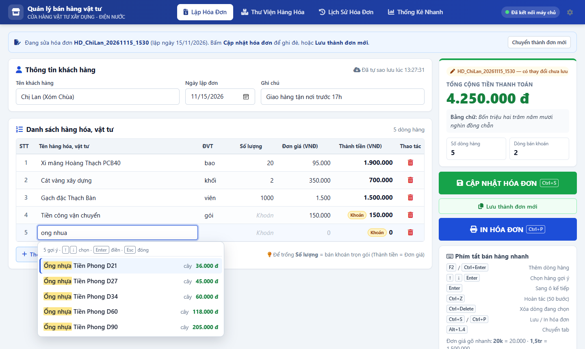
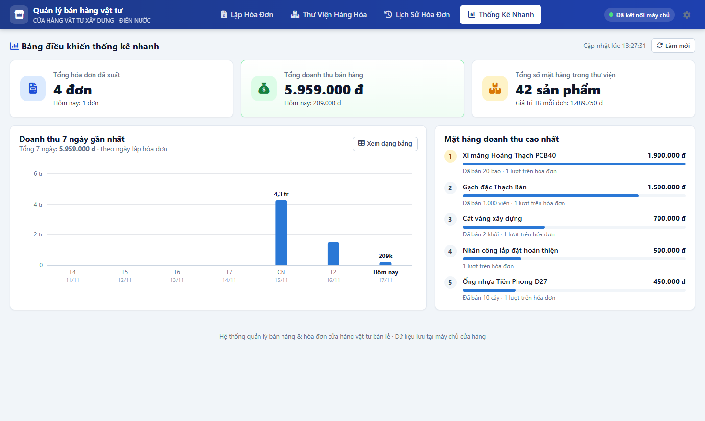
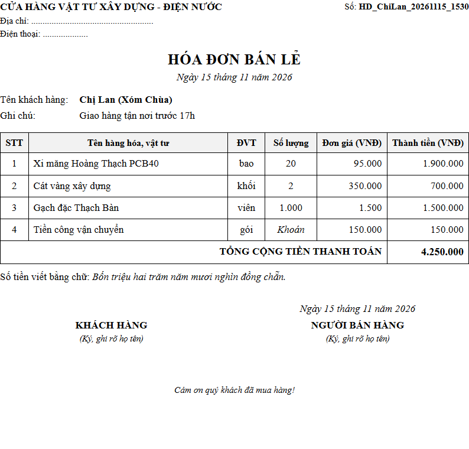
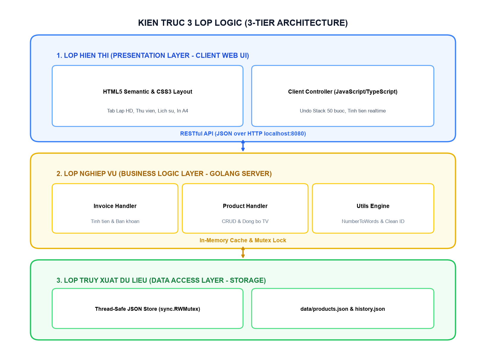
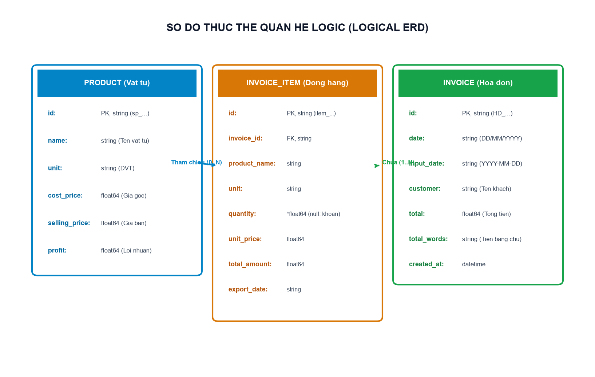

# Hệ thống Quản lý Bán hàng & Hóa đơn Cửa hàng Vật tư Bán lẻ

Ứng dụng web lập hóa đơn bán lẻ cho cửa hàng vật tư xây dựng, thiết bị điện nước, kim khí. Toàn bộ phần mềm đóng gói trong **1 file chạy duy nhất** (`BTKTPMUD.exe`): bấm đúp là trình duyệt tự mở tại `http://localhost:8080`, không cần cài Office, cơ sở dữ liệu hay Internet.

Được xây dựng theo tài liệu đặc tả [`DAC_TA_YEU_CAU_CHO_DEV_WEB.docx`](DAC_TA_YEU_CAU_CHO_DEV_WEB.docx), **phương án A**: Go `net/http` (chỉ dùng thư viện chuẩn) + HTML5/CSS3/JavaScript thuần + lưu trữ file JSON.



| Thống kê nhanh | Phiếu in A4 |
|---|---|
|  |  |

## Tính năng

**Lập hóa đơn (tab mặc định)**
- Bảng hóa đơn động; thành tiền và tổng tiền tính lại ngay khi gõ, không cần nút "Tính tiền".
- **Bán khoán trọn gói**: để trống *Số lượng* thì Thành tiền = Đơn giá, không báo lỗi.
- **Autocomplete** tên hàng từ 1 ký tự, gõ không dấu vẫn tìm được (`ong 21` → *Ống nhựa Tiền Phong D21*); chọn bằng `↑` `↓` `Enter`, tự điền ĐVT + Đơn giá rồi nhảy sang ô Số lượng.
- Đọc số tiền thành chữ tiếng Việt chuẩn ("Một triệu không trăm lẻ năm nghìn đồng chẵn").
- **Hoàn tác 50 bước** (`Ctrl + Z`) cho thêm/xóa dòng, sửa giá, làm mới, nạp đơn cũ.
- Tự sao lưu bản nháp vào trình duyệt; lỡ tải lại trang vẫn khôi phục được hóa đơn đang lập dở.
- **In A4** trực tiếp từ trình duyệt (`@media print`): Times New Roman, bảng kẻ viền, ngày tháng, ô chữ ký.
- Đơn giá gõ nhanh: `20k` = 20.000, `1,5tr` = 1.500.000.

**Thư viện hàng hóa**: thêm, sửa, xóa vật tư; hiện trực tiếp lãi gộp và tỷ lệ lãi (%); tìm kiếm tức thời (debounce 200 ms); sắp xếp theo cột. Mặt hàng mới gõ trên hóa đơn được **tự đồng bộ** vào thư viện khi lưu.

**Lịch sử hóa đơn**: lọc theo tên khách / mã hóa đơn / ngày; Xem chi tiết, **Nạp lại (Sửa)** rồi cập nhật hoặc lưu thành đơn mới, In, Xóa.

**Thống kê nhanh**: tổng số hóa đơn, tổng doanh thu, tổng số mặt hàng; biểu đồ doanh thu 7 ngày; top 5 mặt hàng.

**An toàn dữ liệu**
- Khóa đọc-ghi `sync.RWMutex` + ghi nguyên tử (file `.tmp` → rename): nhiều máy cùng lưu không mất dữ liệu, mất điện không hỏng file.
- Server tự tính lại mọi số tiền (chống sửa số liệu từ client).
- Tự sao lưu dữ liệu mỗi ngày vào `data/backups/` (giữ 14 ngày gần nhất).
- **Chạy ngoại tuyến**: mất kết nối máy chủ vẫn mở được trang (Service Worker), dùng thư viện đã lưu trên máy, lưu tạm hóa đơn (cờ vàng) và tự đồng bộ khi có kết nối lại.

## Chạy phần mềm

### Cách 1: dùng file `.exe` (máy bán hàng)

1. Build (xem bên dưới) hoặc lấy file `BTKTPMUD.exe` từ mục *Artifacts* của GitHub Actions.
2. Đặt `BTKTPMUD.exe` cùng thư mục `data/` (lần đầu chạy nếu chưa có, phần mềm tự tạo `data/` trống).
3. Bấm đúp `BTKTPMUD.exe`: cửa sổ console hiện địa chỉ truy cập, trình duyệt tự mở `http://localhost:8080`.
4. Các máy khác trong mạng LAN truy cập theo địa chỉ in trên console, VD `http://192.168.1.5:8080`.

> Giữ cửa sổ console mở khi bán hàng. Bấm đúp lần nữa khi phần mềm đang chạy thì chỉ mở thêm trình duyệt.

### Cách 2: build từ mã nguồn

Yêu cầu: [Go](https://go.dev/dl/) 1.22 trở lên. Không cần thư viện ngoài.

```bat
:: Windows
build.bat          :: chạy kiểm thử rồi build bin\BTKTPMUD.exe
build.bat run      :: build xong chạy luôn
```

```sh
# Linux / macOS / Git Bash
./build.sh         # build bin/BTKTPMUD
./build.sh all     # build cho Windows, Linux, macOS vào dist/
```

Khi phát triển giao diện, chạy trực tiếp với thư mục `web/` để sửa HTML/CSS/JS không cần build lại:

```sh
go run ./cmd/server -web web
```

### Tham số dòng lệnh

| Tham số | Mặc định | Ý nghĩa |
|---|---|---|
| `-port` | `8080` (hoặc biến môi trường `PORT`) | Cổng HTTP |
| `-host` | `0.0.0.0` | Địa chỉ lắng nghe; `127.0.0.1` để chỉ cho phép máy này truy cập |
| `-data` | `data` | Thư mục chứa file dữ liệu JSON |
| `-web` | *(trống)* | Phục vụ giao diện từ thư mục này thay cho bản nhúng trong exe |
| `-no-browser` | `false` | Không tự mở trình duyệt |

## Phím tắt

| Phím | Chức năng |
|---|---|
| `F2` / `Ctrl + Enter` | Thêm dòng hàng mới, focus vào ô Tên hàng |
| `↑` `↓` `Enter` / `Esc` | Chọn / đóng gợi ý mặt hàng |
| `Enter` | Sang ô kế tiếp (Tên → ĐVT → SL → Đơn giá → dòng sau) |
| `Ctrl + Z` | Hoàn tác (tối đa 50 bước) |
| `Ctrl + Delete` | Xóa dòng đang chọn |
| `Ctrl + S` / `Ctrl + P` | Lưu / In hóa đơn |
| `Alt + 1..4` | Chuyển tab |

## Cấu trúc thư mục

```
├── assets.go                     # Nhúng thư mục web/ vào file exe (go:embed)
├── cmd/server/
│   ├── main.go                   # Entrypoint: HTTP server, mở trình duyệt, sao lưu, tắt an toàn
│   └── console_*.go              # Bật UTF-8 cho console Windows
├── internal/
│   ├── handlers/
│   │   ├── common.go             # Router, middleware, helper JSON
│   │   ├── product_handler.go    # API sản phẩm CRUD
│   │   ├── invoice_handler.go    # API hóa đơn, tự đồng bộ thư viện, sinh mã HĐ
│   │   └── stats_handler.go      # API thống kê & thông tin cửa hàng
│   ├── models/                   # Product, Invoice, InvoiceItem, Settings + validation
│   └── utils/
│       ├── number_to_words.go    # Đọc số thành chữ tiếng Việt
│       ├── file_storage.go       # Kho JSON an toàn luồng (RWMutex + atomic write) + sao lưu
│       └── text.go               # Bỏ dấu tiếng Việt, chuẩn hóa tên khách cho mã HĐ
├── web/
│   ├── index.html                # Single Page Application 4 tab
│   ├── css/style.css             # Giao diện responsive + @media print A4
│   ├── js/
│   │   ├── utils.js              # Thuật toán lõi: tính tiền, đọc số, Undo stack, định dạng
│   │   ├── app.js                # Tabs, state, phím tắt, hộp thoại, trạng thái kết nối
│   │   ├── api.js                # Gọi API + chế độ ngoại tuyến (LocalStorage)
│   │   ├── invoice.js            # Bảng hóa đơn, Autocomplete, Undo, Lưu, In
│   │   ├── products.js           # Thư viện vật tư
│   │   ├── history.js            # Tra cứu, nạp lại, in, xóa hóa đơn
│   │   └── dashboard.js          # Thống kê nhanh
│   ├── sw.js                     # Service Worker (mở trang khi mất kết nối)
│   └── vendor/fontawesome/       # Font Awesome Free (đóng gói sẵn, không cần Internet)
├── data/
│   ├── products_data.json        # Thư viện hàng hóa (42 mặt hàng mẫu)
│   ├── history_data.json         # Lịch sử hóa đơn (4 hóa đơn mẫu)
│   └── settings.json             # Thông tin cửa hàng in trên hóa đơn
├── tests/
│   ├── js/utils.test.js          # Kiểm thử thuật toán phía client (node --test)
│   ├── testdata/number_words.json# Bộ dữ liệu đọc số dùng chung cho test Go và JS
│   └── e2e/                      # Kiểm thử nghiệm thu TC01–TC15 trên trình duyệt thật
├── docs/                         # Tài liệu API, biên bản nghiệm thu, sơ đồ
├── build.bat / build.sh          # Script build
└── .github/workflows/ci.yml      # CI: test + build + E2E
```

## REST API

Chi tiết request/response: [`docs/API.md`](docs/API.md).

| Phương thức | Đường dẫn | Mục đích |
|---|---|---|
| `GET` | `/api/products` | Danh sách thư viện vật tư |
| `POST` | `/api/products` | Thêm mặt hàng |
| `GET` / `PUT` / `DELETE` | `/api/products/:id` | Xem / sửa / xóa mặt hàng |
| `GET` | `/api/invoices?search=&date=` | Lịch sử hóa đơn (mới nhất trước) |
| `POST` | `/api/invoices` | Lưu hóa đơn mới (tự tính tiền, đọc chữ, sinh mã, đồng bộ thư viện) |
| `GET` / `PUT` / `DELETE` | `/api/invoices/:id` | Xem / cập nhật / xóa hóa đơn |
| `GET` | `/api/stats` | Số liệu thống kê nhanh |
| `GET` / `PUT` | `/api/settings` | Thông tin cửa hàng in trên hóa đơn |
| `GET` | `/api/health` | Kiểm tra kết nối |

`PUT /api/invoices/:id`, `/api/stats`, `/api/settings`, `/api/health` là phần mở rộng ngoài đặc tả, phục vụ chức năng "Nạp lại → Cập nhật đơn", tab Thống kê, tiêu đề phiếu in và phát hiện mất kết nối.

## Kiểm thử

```sh
go test ./internal/...              # 21 test backend (gồm test 60 request ghi đồng thời)
node --test "tests/js/*.test.js"    # 10 test thuật toán phía client

# Kiểm thử nghiệm thu E2E (cần build trước; dùng Edge/Chrome có sẵn trên máy)
cd tests/e2e
npm install
npm test                            # 28 kiểm tra, gồm đủ TC01–TC15
```

Kết quả nghiệm thu: [`docs/NGHIEM_THU.md`](docs/NGHIEM_THU.md).

## Dữ liệu

- Dữ liệu lưu trong `data/*.json`, định dạng đúng theo mục 2 của đặc tả. Có thể mở xem bằng trình soạn thảo bất kỳ.
- Muốn bắt đầu với dữ liệu trống: tắt phần mềm, xóa `data/history_data.json` (và/hoặc `products_data.json`); lần chạy sau phần mềm tự tạo file rỗng.
- Khôi phục: chép file từ `data/backups/YYYYMMDD/` đè vào `data/` khi phần mềm đã tắt.
- Nếu sửa tay file JSON khi phần mềm đang chạy, phần mềm tự nạp lại; nếu file bị sai định dạng, phần mềm báo lỗi và giữ nguyên dữ liệu cũ.

## Kiến trúc

| Kiến trúc 3 lớp | Mô hình dữ liệu |
|---|---|
|  |  |

Luồng lưu hóa đơn: [sequence diagram](docs/images/05-sequence-luu-hoa-don.png) · Quy trình lập hóa đơn & bán khoán: [activity diagram](docs/images/04-activity-lap-hoa-don.png)

## Thư viện bên thứ ba

- [Font Awesome Free 6.7.2](https://fontawesome.com) (icon: CC BY 4.0, font: SIL OFL 1.1, code: MIT), đóng gói trong `web/vendor/fontawesome/`.
- Backend chỉ dùng thư viện chuẩn của Go.
